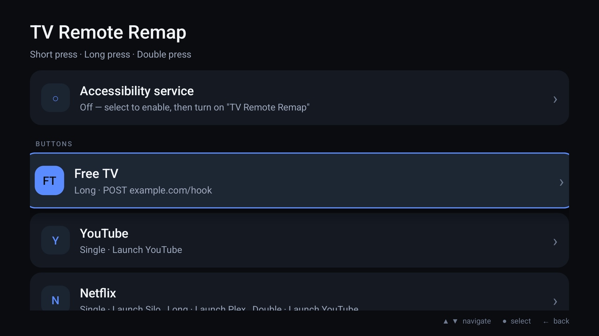
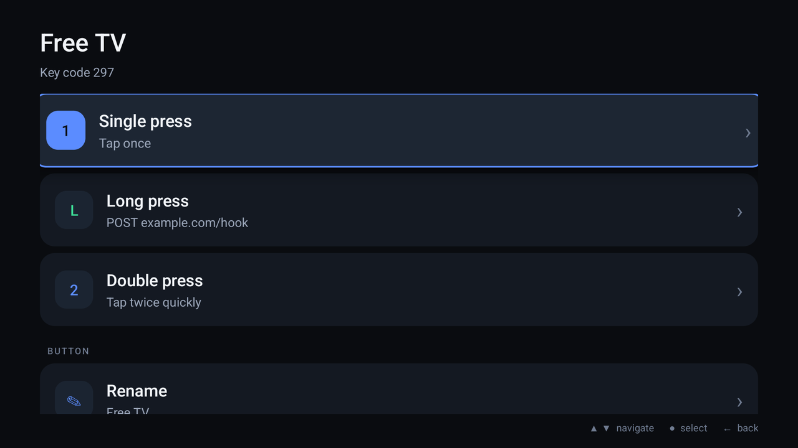
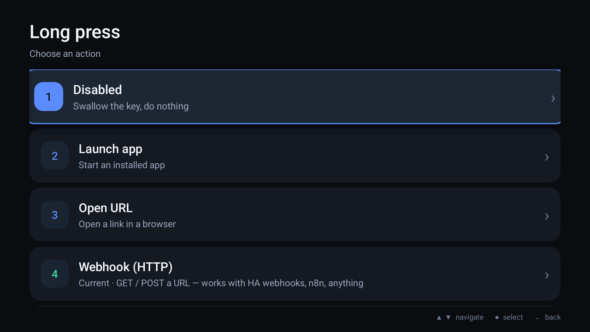
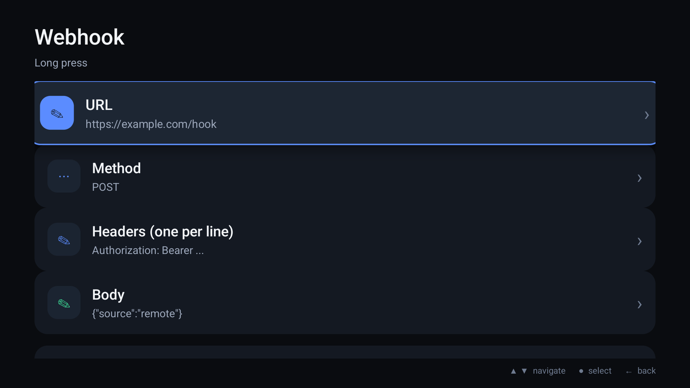
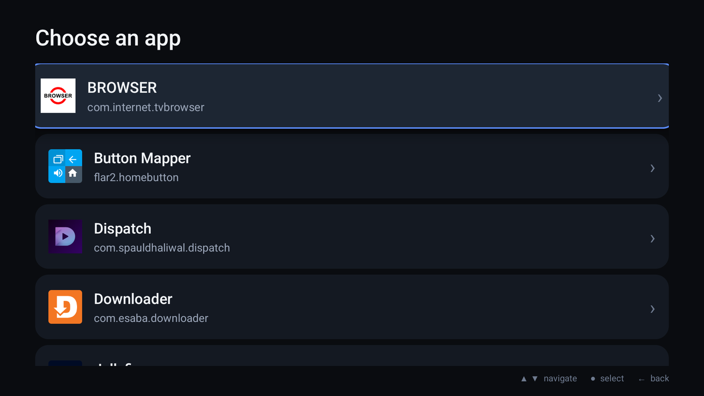
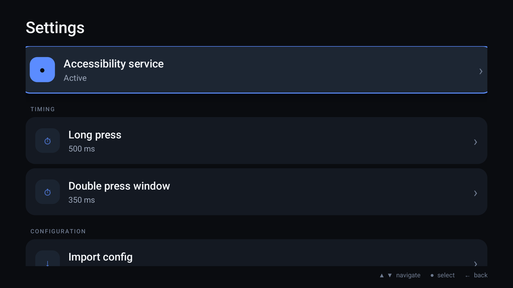

# TV Remote Remap

Turn the branded app buttons on an Android TV / Google TV remote into anything
you want — a different app, a webhook, a Home Assistant service, the voice
assistant, a system action, or nothing at all.

Retail remotes ship with hard-wired buttons (Free TV, Netflix, Disney+, …) that
launch apps you may not use, and most TVs have no setting to change them. On a
non-rooted TV the keylayout is read-only, so this app does it the only way that
works without root: a small [AccessibilityService](https://developer.android.com/reference/android/accessibilityservice/AccessibilityService)
that filters key events (`FLAG_REQUEST_FILTER_KEY_EVENTS`) before the foreground
app sees them. Configured keys are consumed; everything else passes through.

## Screenshots

<p align="center">
  
  
  
</p>
<p align="center">
  
  
  
</p>

## Features

- **Three press types per button** — single press, long press (hold) and double
  press, each with its own action and its own timing setting.
- **Actions**
  - Launch any installed app (leanback-aware, with launch-intent fallback)
  - Open a URL
  - Webhook: `GET`/`POST`/`PUT`/`PATCH`/`DELETE`, custom headers and JSON body
  - Home Assistant: base URL + long-lived token + `domain.service` + entity
  - Voice assistant: system `ACTION_VOICE_COMMAND`, `ACTION_ASSIST`, or a
    specific assistant package
  - System actions: Back, Home, Recents, Notifications, Quick settings, Power
    menu, Lock screen, Screenshot
  - Intent URI (explicit `intent://…#Intent;…;end`)
  - Disabled: swallow the key and do nothing
- **Modern TV UI** — dark 10-foot interface, focus cards, D-pad navigation,
  value rows that open edit dialogs instead of trapping focus in text fields.
- **Capture any button** — "Add a button", press the key once, it is added.
- **Config import / export** — plain JSON in the app's files directory.
- No root, no daemon, survives reboot: the service is bound by the system.

## Install

```bash
adb install -r tv-remote-remap-0.2.0.apk

# enable the accessibility service (keeps whatever is already enabled)
CUR=$(adb shell settings get secure enabled_accessibility_services | tr -d '\r')
adb shell settings put secure enabled_accessibility_services \
  "$CUR:app.tvremote.remap/app.tvremote.remap.RemapService"
adb shell settings put secure accessibility_enabled 1
```

Reinstalling the APK can drop the service from the enabled list — re-run the two
`settings put` lines after an update.

Verify it is live:

```bash
adb shell dumpsys accessibility | grep -A1 'TV Remote Remap'   # capabilities=8
adb logcat -s TVRemap:*                                        # connect + one line per press
```

## Usage

1. Open **TV Remote Remap** from the TV's app row.
2. **Add a button** → press the remote key you want (e.g. the Netflix button).
3. Pick the press type → pick an action → fill in its parameters → **Save**.
4. Press the button. `adb logcat -s TVRemap:*` shows every intercept and launch.

## Revert

```bash
CUR=$(adb shell settings get secure enabled_accessibility_services | tr -d '\r')
adb shell settings put secure enabled_accessibility_services \
  "${CUR/:app.tvremote.remap\/app.tvremote.remap.RemapService/}"
adb uninstall app.tvremote.remap
```

## Config format

Everything lives in one JSON blob (`SharedPreferences`), exported by
**Settings → Export config** to
`/sdcard/Android/data/app.tvremote.remap/files/config.json`.

```json
{
  "version": 2,
  "longPressMs": 500,
  "doublePressMs": 350,
  "buttons": [
    {
      "code": 191,
      "name": "Netflix",
      "single": { "type": "APP", "pkg": "org.siloserver.silo",
                  "activity": "org.siloserver.silo.tv.MainTvActivity",
                  "label": "Silo" },
      "long":   { "type": "HA", "base": "http://homeassistant.local:8123",
                  "token": "…", "service": "light.toggle",
                  "entity": "light.living_room" },
      "double": { "type": "HTTP", "url": "https://example.com/hook",
                  "method": "POST", "headers": "Authorization: Bearer …",
                  "body": "{\"button\":\"netflix\"}" }
    },
    { "code": 297, "name": "Free TV", "single": { "type": "NONE" } }
  ]
}
```

Key codes are Android `KeyEvent` constants — the keylayout maps the physical
button to one (`adb shell dumpsys input` → `KeyLayoutFile`). An example for the
onn. 4K Plus remote is in [`examples/onn-4k-plus.json`](examples/onn-4k-plus.json).

**Bulk load**: drop a file named `import.json` into the app's files directory
and start the app; it is imported and renamed `imported.json`.

```bash
adb push my-config.json /sdcard/Android/data/app.tvremote.remap/files/import.json
adb shell am start -n app.tvremote.remap/.MainActivity
```

## Build

No Gradle. `build.sh` drives `aapt2` → `javac` → `d8` → `zipalign` → `apksigner`
directly, which keeps CI fast and the output reproducible with a plain SDK:

```bash
export ANDROID_HOME=$HOME/Android/Sdk   # build-tools + a platform are required
./build.sh                              # -> dist/tv-remote-remap-<version>.apk
```

Signing comes from `KEYSTORE_BASE64` (base64 JKS/PKCS12), then `KEYSTORE_FILE`,
otherwise an ephemeral debug keystore is generated. Passwords:
`KEYSTORE_PASSWORD`, `KEY_ALIAS`, `KEY_PASSWORD`.

The GitHub Actions workflow builds every push and pull request **without any
secrets** (unsigned APK, artifact only). A `v*` tag is the only path that gets
the release keystore: it signs, verifies the signature, and a separate
release job publishes the APK and `SHA256SUMS`. If the signing secret is
missing, the tag build fails instead of shipping a debug-signed release.

## Security notes

- Configuration lives in the app's private `SharedPreferences`, written by the
  app only. Home Assistant tokens and webhook `Authorization` headers are stored
  **in plain text** there and are masked in the UI; treat the TV as a trusted
  device for those credentials.
- **Exporting the config writes those secrets to
  `/sdcard/Android/data/app.tvremote.remap/files/config.json`** — a world-readable
  location for anything with storage access. The app asks for confirmation before
  exporting; delete the file after copying it.
- Cleartext HTTP is allowed so LAN webhooks and Home Assistant on `http://` work.
  Prefer `https://` for anything that leaves your network.
- `import.json` is imported automatically when the app starts. It is a privileged
  operation (it can create mappings); only drop files there that you trust.
- Navigation keys (Back, Home, D-pad, volume, power) are rejected by both capture
  and import, so a bad mapping can never trap the remote.

## Limitations

- `adb shell input keyevent` and other injected events bypass the accessibility
  key filter, so they cannot be used to test remaps — only real presses work.
- A button consumed by a vendor service before the accessibility layer will not
  be seen. Check `adb logcat -s TVRemap:*` while pressing.
- Lock screen / screenshot actions need Android 9+.
- The app remaps keys; it cannot remap buttons whose events the vendor firmware
  never sends to Android.

## License

MIT — see [LICENSE](LICENSE).
